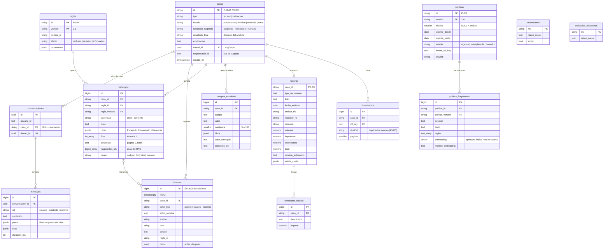
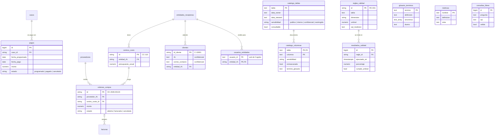

# Esquema de la base de datos

Tareas 0.3.1 a 0.3.5. Fuente de verdad: [`datos/steward_datos/db/models.py`](../../datos/steward_datos/db/models.py) y la migración [`0001_esquema_inicial.py`](../../datos/alembic/versions/0001_esquema_inicial.py).

## Diagrama entidad-relación

`proveedores` y `entidades_receptoras` son catálogos sin relación formal: las reglas R-017 y R-018 los consultan por RFC.

## Negocio y gobernanza (migración 0002)

Además: `casos.origen` (`aplicacion`, `semilla` o `negocio`), `facturas.orden_compra_id` y en `proveedores` la categoría, el correo de facturación y el plazo de pago.

Las **vistas consultables** (`v_facturas`, `v_proveedores`, `v_casos`, `v_hallazgos`, `v_ordenes_compra`, `v_pagos`, `v_centros_costo`, `v_clientes`) y su seguridad por fila están en [vistas_y_catalogo.md](vistas_y_catalogo.md).

## Decisiones

| Decisión | Por qué |
|---|---|
| Catálogos de valores como texto con `CHECK`, no `ENUM` | Agregar un estado nuevo es un `ALTER ... CHECK`, no una migración de tipo. |
| `casos.id` legible (`F-1042`, `V-0207`) generado con secuencias | Es el ID que ve el analista; coincide con el frontend. Secuencias en `F-1100` y `V-0208` para no chocar con la semilla. |
| `campos_extraidos` aparte de `facturas` | La interfaz muestra confianza y correcciones por campo; `facturas` guarda los valores normalizados para consultas (`buscar_facturas`). |
| `valor` y `valor_corregido` separados | La corrección humana no borra lo que leyó el modelo; las dos versiones quedan para auditoría y evaluación. |
| Hallazgos con FK a `(regla_id, regla_version)` | Cada hallazgo apunta a una versión exacta de la regla, como exige el README. |
| Bitácora solo de inserción (trigger) | Es el registro oficial: un `UPDATE` o `DELETE` falla aunque lo intente el backend. |
| `politicas.historia` NULL = ambas | P-011 (RFC) aplica a facturas y a registros. |
| `modelo_embedding` en cada fragmento | `buscar_politicas` filtra por el modelo configurado, así nunca compara vectores de modelos distintos. |
| `mensajes.pasos` en JSONB | Guarda tal cual la línea de pasos que mostró el chat (eventos SSE), para reconstruir la conversación. |
| Checkpoints de LangGraph fuera del esquema | Los crea `PostgresSaver.setup()`; `alembic/env.py` los ignora al autogenerar. |

## Permisos (mínimo privilegio)

La migración otorga permisos si existen los usuarios que crea Infraestructura (1.3.2):

| Usuario | Permisos |
|---|---|
| `steward_backend` | Lectura y escritura en todas las tablas, excepto `UPDATE`/`DELETE` en `bitacora`. |
| `steward_mcp` | Solo lectura, más `INSERT` en `hallazgos`, `bitacora` y `consultas_libres`. |
| `steward_consultas` | Solo `SELECT` sobre las vistas consultables, con `statement_timeout` de 5 s (para `ejecutar_consulta`). |
